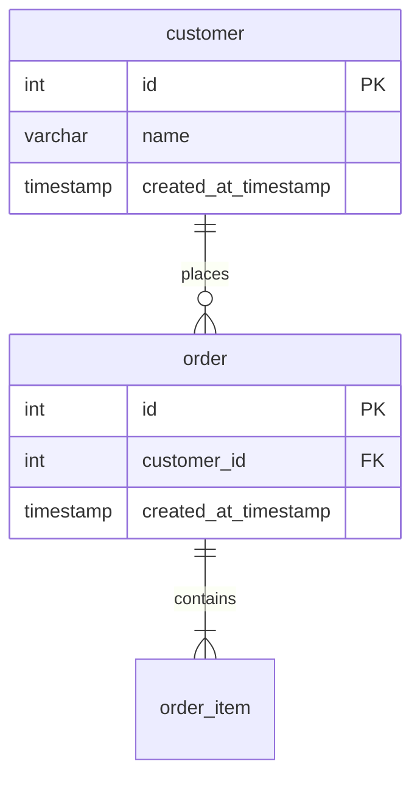

# EMSMC Database Designer

Design, create, review, and optimize database schemas for PostgreSQL, SQL Server, and MySQL with strict conventions.

This skill produces **ER diagrams** (Mermaid) and **SQL DDL scripts**. It does NOT generate application code (EF Core entities, migrations) — a separate skill handles that from the SQL scripts this skill produces.

## Workflow

When the user asks for database work, follow this sequence. Skip steps that don't apply (e.g., skip ER diagram for a single ALTER TABLE).

```
1. UNDERSTAND  → Clarify requirements, entities, relationships, expected data volumes
2. MODEL       → Draw Mermaid erDiagram showing entities and relationships
3. GENERATE    → Write DDL scripts following all conventions below
4. REVIEW      → Check naming, types, indexes, constraints, triggers against rules
```

For **multi-engine** requests, generate separate `.sql` files per engine. For **single-engine** requests, generate one file. Default to PostgreSQL if the user doesn't specify.

## ER Diagram Format

Always use Mermaid `erDiagram` syntax. Include relationship cardinality and key columns.



Use standard crow's foot notation: `||--o{` (one-to-many), `||--||` (one-to-one), `}o--o{` (many-to-many via junction table).

## Mandatory Table Structure

Every table MUST include these columns. This is non-negotiable — these columns exist on every single table regardless of purpose.

### Standard Columns (all tables)

| Column | PostgreSQL | SQL Server | MySQL | Notes |
|--------|-----------|------------|-------|-------|
| `id` | `int4` or `int8` | `int` or `bigint` | `int` or `bigint` | PK. Identity. Choose based on expected row count. |
| `created_at_timestamp` | `timestamp` | `datetime2` | `datetime` | UTC. Set by trigger on INSERT. Immutable after creation. |
| `updated_at_timestamp` | `timestamp` | `datetime2` | `datetime` | UTC. Set by trigger on INSERT and UPDATE. |

### Additional Columns (user-facing tables)

Tables exposed to end users (not internal/system/junction tables) also include:

| Column | Type | Notes |
|--------|------|-------|
| `created_by_user_name` | `varchar(200)` | Set by the application, not triggers. |
| `updated_by_user_name` | `varchar(200)` | Set by the application, not triggers. |

### How to Decide int4 vs int8

- **int4** (`int`): Tables expected to hold < 2 billion rows (most tables).
- **int8** (`bigint`): High-volume tables — logs, events, transactions, audit trails, or anything that could exceed 2B rows over the system's lifetime.

## Primary Key Rules

PKs are ALWAYS integer identity columns. Never composite keys (single column only).

**PostgreSQL:**
```sql
"id" int4 NOT NULL GENERATED ALWAYS AS IDENTITY (START WITH 1 MINVALUE 1 INCREMENT BY 1 NO CYCLE)
```

**SQL Server:**
```sql
[id] int NOT NULL IDENTITY(1, 1)
```

**MySQL:**
```sql
`id` int NOT NULL AUTO_INCREMENT
```

## Foreign Key Rules

**FKs must NEVER use CASCADE or SET NULL.** Always use RESTRICT (the default when no action is specified). The application is responsible for managing deletion order and referential integrity cleanup.

The reasoning: CASCADE and SET NULL create implicit side effects that are hard to trace, can cause accidental mass deletions, and make debugging difficult. Explicit application-level handling is safer and more auditable.

```sql
-- Correct
CONSTRAINT "fk_order__customer_id__customer"
    FOREIGN KEY ("customer_id") REFERENCES "customer" ("id")

-- WRONG — never do this
FOREIGN KEY ("customer_id") REFERENCES "customer" ("id") ON DELETE CASCADE
FOREIGN KEY ("customer_id") REFERENCES "customer" ("id") ON DELETE SET NULL
```

## FILLFACTOR Rules

| Object | FILLFACTOR |
|--------|-----------|
| Table | 90 |
| Primary Key | 100 |
| Unique Key | 90 |
| Index | 90 |

Apply FILLFACTOR in DDL for PostgreSQL and SQL Server. MySQL does not support FILLFACTOR.

## Timestamp Trigger

Every table must have a trigger that manages `created_at_timestamp` and `updated_at_timestamp`. The `created_at_timestamp` is immutable — once set on INSERT, it is never changed.

**PostgreSQL** — create a reusable function, then attach it to each table:

```sql
CREATE OR REPLACE FUNCTION fn_set_timestamps()
RETURNS trigger AS $$
BEGIN
    IF TG_OP = 'INSERT' THEN
        NEW.created_at_timestamp = now() AT TIME ZONE 'UTC';
        NEW.updated_at_timestamp = now() AT TIME ZONE 'UTC';
    ELSIF TG_OP = 'UPDATE' THEN
        NEW.created_at_timestamp = OLD.created_at_timestamp;  -- immutable
        NEW.updated_at_timestamp = now() AT TIME ZONE 'UTC';
    END IF;
    RETURN NEW;
END;
$$ LANGUAGE plpgsql;

-- Per table:
CREATE TRIGGER "trg_customer__timestamps"
    BEFORE INSERT OR UPDATE ON "customer"
    FOR EACH ROW EXECUTE FUNCTION fn_set_timestamps();
```

**SQL Server** — per-table trigger:

```sql
CREATE TRIGGER [trg_customer__timestamps]
ON [customer]
AFTER INSERT, UPDATE
AS
BEGIN
    SET NOCOUNT ON;

    -- On INSERT: set both
    UPDATE t SET
        t.[created_at_timestamp] = SYSUTCDATETIME(),
        t.[updated_at_timestamp] = SYSUTCDATETIME()
    FROM [customer] t
    INNER JOIN inserted i ON t.[id] = i.[id]
    WHERE NOT EXISTS (SELECT 1 FROM deleted);

    -- On UPDATE: only updated_at, preserve created_at
    UPDATE t SET
        t.[updated_at_timestamp] = SYSUTCDATETIME()
    FROM [customer] t
    INNER JOIN inserted i ON t.[id] = i.[id]
    WHERE EXISTS (SELECT 1 FROM deleted);
END;
```

**MySQL** — per-table trigger pair:

```sql
CREATE TRIGGER `trg_customer__before_insert`
BEFORE INSERT ON `customer`
FOR EACH ROW
BEGIN
    SET NEW.`created_at_timestamp` = UTC_TIMESTAMP();
    SET NEW.`updated_at_timestamp` = UTC_TIMESTAMP();
END;

CREATE TRIGGER `trg_customer__before_update`
BEFORE UPDATE ON `customer`
FOR EACH ROW
BEGIN
    SET NEW.`created_at_timestamp` = OLD.`created_at_timestamp`;  -- immutable
    SET NEW.`updated_at_timestamp` = UTC_TIMESTAMP();
END;
```

## Naming Conventions

All identifiers: **lowercase**, **snake_case**, **quoted** (`"x"` PostgreSQL, `[x]` SQL Server, `` `x` `` MySQL).

| Object | Prefix | Format | Example |
|--------|--------|--------|---------|
| Table | — | `snake_case` | `order_item` |
| View | `vw_` | `vw_<name>` | `vw_active_orders` |
| Stored Procedure | `usp_` | `usp_<verb>_<noun>` | `usp_calculate_totals` |
| Function | `fn_` | `fn_<verb>_<noun>` | `fn_get_full_name` |
| Partition Function | `pfn_` | `pfn_<verb>_<noun>` | `pfn_partition_by_date` |
| Index | `ix_` | `ix_<table>__<col1>__<col2>` | `ix_order__customer_id` |
| Primary Key | `pk_` | `pk_<table>` | `pk_order` |
| Foreign Key | `fk_` | `fk_<table>__<col>__<ref_table>` | `fk_order__customer_id__customer` |
| Unique Key | `uk_` | `uk_<table>__<col1>__<col2>` | `uk_customer__email` |
| Check Constraint | `ck_` | `ck_<table>__<col>` | `ck_order__total_amount` |
| Trigger | `trg_` | `trg_<table>__<purpose>` | `trg_order__timestamps` |
| Enum | `enum_` | `enum_<name>` | `enum_order_status` |
| Domain | `dm_` | `dm_<name>` | `dm_email` |
| Sequence | `seq_` | `seq_<name>` | `seq_order_id` |
| Synonym | `sn_` | `sn_<base_prefix><name>` | `sn_vw_active_orders` |

**Double underscore** (`__`) separates table name from columns in constraint/index names.

**Identifier length limits** — PostgreSQL/MySQL: 63 chars, SQL Server: 128 chars. Constraint and index names combine prefixes, table names, and column names, so they regularly exceed 63 characters. Before outputting DDL, count the characters of every FK, IX, UK, and CK name. If a name exceeds the limit, apply truncation:

| Object | Step 1 | Step 2 |
|--------|--------|--------|
| **FK** | Remove referenced table (`fk_<table>__<cols>`) | Remove columns, numeric suffix (`fk_<table>_1`) |
| **IX** | Remove columns, add `__plus` (`ix_<table>__plus`) | Numeric suffix (`ix_<table>_1`) |
| **UK** | Remove columns, add `__plus` (`uk_<table>__plus`) | Numeric suffix (`uk_<table>_1`) |
| **CK** | Remove column, numeric suffix (`ck_<table>_1`) | — |

**Example** (PostgreSQL): `fk_notification_preference__notification_channel_id__notification_channel` is 73 chars — exceeds 63. Step 1: remove referenced table → `fk_notification_preference__notification_channel_id` (52 chars, fits).

**Junction tables** (many-to-many): `<parent_table>_<child_table>`. Parent is the stronger/categorizing entity.

**Column naming:**
- PK: always `id`
- FK columns: end with `_<referenced_table>_<referenced_column>` when natural (e.g., `customer_id`). Shorten if ugly or too long.
- Booleans: `is_` or verb prefix (`has_`, `contains_`). Must be `NOT NULL` with `DEFAULT`.
- Dates: `_date` suffix. Datetimes: `_datetime` suffix. Timestamps: `_timestamp` suffix (except `row_version`).

**Enum values**: PascalCase with underscores (`Pending`, `In_Progress`, `Completed`). Must match application code exactly.

For the complete naming convention reference with detailed examples and edge cases, read `references/naming-conventions.md`.

## Data Type Selection

Read `references/engine-specifics.md` for the full type mapping table. Key rules:

- **PostgreSQL**: `jsonb` (not `json`), always with DEFAULT. `timestamp` for date/time with time component. `bool` for booleans.
- **SQL Server**: `nvarchar`/`ntext` (not `varchar`/`text`) — EMS standard. `datetime2` for timestamps. `bit` for booleans. `ROWVERSION` instead of deprecated `TIMESTAMP`.
- **MySQL**: `tinyint` for booleans. `datetime` for timestamps.
- **All engines**: timestamps stored in UTC.

## Index Strategy

Read `references/sql-best-practices.md` for the full guide. Key rules:

1. **Column order matters**: high-cardinality columns first.
3. Columns used in WHERE clauses should be covered by an index. One index per table is used for data access — all WHERE columns should be in one index.
4. Never use functions on the left side of comparisons (breaks index usage).
5. **Partitioning**: tables that store historical data must be partitioned by day or month, depending on insert volume and purge frequency.

## Security & Audit Patterns

- **Audit columns** (`created_by_user_name`, `updated_by_user_name`, timestamps) are the baseline for all user-facing tables.
- **Soft delete**: when needed, add `is_deleted boolean NOT NULL DEFAULT false` and `deleted_at_timestamp`. Filter in application queries, not database views (unless performance requires a filtered index).
- **Row-level security**: use PostgreSQL RLS policies, SQL Server security predicates, or application-level filtering. Document which approach in the schema comments.

## Complete Table Example

Putting it all together for PostgreSQL:

```sql
CREATE TABLE "customer" (
    "id"                    int4        NOT NULL GENERATED ALWAYS AS IDENTITY (START WITH 1 MINVALUE 1 INCREMENT BY 1 NO CYCLE),
    "name"                  varchar(200) NOT NULL,
    "email"                 varchar(300) NOT NULL,
    "is_active"             bool        NOT NULL DEFAULT true,
    "created_by_user_name"  varchar(200) NULL,
    "updated_by_user_name"  varchar(200) NULL,
    "created_at_timestamp"  timestamp   NOT NULL DEFAULT (now() AT TIME ZONE 'UTC'),
    "updated_at_timestamp"  timestamp   NOT NULL DEFAULT (now() AT TIME ZONE 'UTC'),

    CONSTRAINT "pk_customer" PRIMARY KEY ("id") WITH (FILLFACTOR = 100),
    CONSTRAINT "uk_customer__email" UNIQUE ("email") WITH (FILLFACTOR = 90)
) WITH (FILLFACTOR = 90);

CREATE TRIGGER "trg_customer__timestamps"
    BEFORE INSERT OR UPDATE ON "customer"
    FOR EACH ROW EXECUTE FUNCTION fn_set_timestamps();
```

## Checklist

Before outputting any DDL, verify:

1. All identifiers are lowercase, snake_case, properly quoted.
2. Every table has: `id` (int identity PK), `created_at_timestamp`, `updated_at_timestamp`.
3. User-facing tables also have `created_by_user_name`, `updated_by_user_name`.
4. PK is a single integer identity column, never composite.
5. All FKs use RESTRICT (no CASCADE, no SET NULL).
6. FILLFACTOR is set: table 90, PK 100, UK 90, IX 90.
7. Timestamp trigger exists for every table.
8. Booleans have `is_`/verb prefix, NOT NULL, DEFAULT.
9. Date/datetime/timestamp columns have the correct suffix.
10. Correct naming prefix for each object type.
11. Double underscores in constraint/index names.
12. **Every FK, IX, UK, and CK name has been character-counted** against the engine's max length (63 for PostgreSQL/MySQL, 128 for SQL Server). If any exceeds the limit, truncation rules have been applied.
13. Correct quoting style for the target engine.
14. High-cardinality columns first in indexes.

## Reference Files

For detailed content beyond what's covered above, read these files from the `references/` directory:

- **`naming-conventions.md`** — Full naming rules with examples, truncation strategies, edge cases.
- **`engine-specifics.md`** — Complete data type mapping, engine-specific syntax, PostgreSQL/SQL Server/MySQL differences.
- **`sql-best-practices.md`** — Query writing rules, CTE usage, JOIN optimization, indexed views, stored procedure limits, partitioning guidelines.

## Using this skill in Prism

The conventions above are the EMSMC DBA standard and apply unchanged. This section only says how they meet Prism's stack. Do not weaken or reinterpret a convention above to fit Prism; if one does not fit, say so and ask.

- **Scope:** Prism's own database is PostgreSQL only. Ignore the SQL Server, MySQL and Snowflake guidance for Prism work, but keep it intact in this file.
- **Who writes what:** the Prism schema is owned by EF Core. Write entities and entity configurations, then generate migrations. Use this skill's DDL output as the specification the EF model must match, or for standalone ops scripts. Do not hand-write DDL that the EF model also defines.
- **Warehouse:** Prism reads the data warehouse through a read-only connection. Never create migrations, DDL or schema changes for the warehouse.
- **New project, no legacy:** every Prism object follows these conventions from the first migration, including the double underscore between table and columns in index and constraint names.
- **Details for EF Core and migrations:** read `references/prism-ef-core.md`.
